# PetTask

## Integrantes

- **Líder:** Espinoza Cuevas Diego Omar
- Alvarez Del valle Angel
- Dector Montiel Norma Angelica
- Hernandez Camargo Bryan Yael
- Nolasco Gómez Jose Daniel
- Ordaz Cano Mariana
- Sandoval Resendiz Alexander Emir
- Zarate Garrido Adolfo Alexander 

---

## Descripción

**PetTask** es una aplicación web orientada a estudiantes que permite organizar y gestionar sus tareas académicas de una manera sencilla y visual.

La aplicación permite registrar, consultar, actualizar y eliminar tareas, además de incorporar elementos de gamificación mediante una mascota virtual, una tienda, una racha de actividad y recordatorios.

---

## Objetivo

El objetivo de PetTask es facilitar la organización de las actividades académicas del usuario mediante una aplicación web responsive que combine la gestión de tareas con elementos de gamificación.

La aplicación busca motivar al usuario a mantener una actividad constante mediante una mascota virtual, niveles, rachas y otras funciones relacionadas con el cumplimiento de tareas.

---

## Tecnologías utilizadas

- HTML5
- CSS3
- JavaScript
- Bootstrap 5.3.8
- Bootstrap Icons
- Google Fonts
  - Questrial
  - Onest
- Git
- GitHub

---

## Características principales

PetTask cuenta con las siguientes funcionalidades:

- Inicio de sesión.
- Registro de usuario.
- Carga de datos generales.
- Consulta de tareas.
- Agregar tareas.
- Actualizar tareas.
- Eliminar tareas.
- Interacción con mascota virtual.
- Tienda de mascota.
- Racha de actividad.
- Recordatorios.
- Diseño responsive para computadora y dispositivos móviles.

---

## Requerimientos funcionales  

|   ID   |        Nombre            |
_ _ _ _ _ _ _ _ _ _ _ _ _ _ _ _ _ _ _

| RF-001 | Inicio de sesión         |

| RF-002 | Registrarse              |

| RF-003 | Carga de datos general   |

| RF-004 | Ver tareas               |

| RF-005 | Agregar tareas           |

| RF-006 | Actualizar tarea         |

| RF-007 | Eliminar tareas          |

| RF-008 | Interacción con mascota  |

| RF-009 | Tienda de mascota        |

| RF-010 | Racha de actividad       |

---

## Componentes de Bootstrap utilizados

- El proyecto utiliza diferentes componentes y utilidades de Bootstrap para construir la interfaz:

- Navbar responsive: barra de navegación adaptable a distintos tamaños de pantalla.

- Collapse: permite expandir y contraer el menú de navegación.

- Cards: contenedores para mostrar tareas, formularios, resúmenes y otra información.

- Form Controls: campos de entrada y etiquetas de formularios (form-control y form-label).

- Modal: ventana de confirmación para eliminar tareas.

- Buttons: botones de Bootstrap usados en el modal, incluidos los estilos btn-secondary, btn-danger y btn-close

---

## Diseño

PetTask utiliza una guía de diseño basada en **Material Design**, buscando mantener una interfaz coherente, accesible y adaptable a diferentes tamaños de pantalla.

### Paleta de colores

| Color       | Código    | Uso                               |
_ _ _ _ _ _ _ _ _ _ _ _ _ _ _ _ _ _ _ _ _ _ _ _ _ _ _ _ _ _ _ _
| Fondo       | `#E5EAF5` | Fondo principal                   |

| Blanco      | `#FFFFFF` | Tarjetas y elementos de contenido |

| Rosa        | `#FF6F82` | Acciones y elementos destacados   |

| Azul claro  | `#8FA3ED` | Bordes y elementos secundarios    |

| Azul        | `#557FFC` | Elementos principales             |

| Azul oscuro | `#1E1E50` | Textos y títulos                  |

### Tipografías

- **Questrial:** títulos y encabezados.
- **Onest:** contenido, formularios, botones y elementos de navegación.

---

## Estructura del proyecto

```text
PetTask/
├── index.html
├── nosotros.html
├── servicios.html
├── contacto.html
├── iniciar-sesion.html
├── registro.html
├── carga-de-datos-general.html
├── ver-tareas.html
├── agregar-tareas.html
├── actualizar-tarea.html
├── eliminar-tareas.html
├── interaccion-con-mascota.html
├── tienda-de-mascota.html
├── racha-de-actividad.html
├── README.md
├── css/
│   ├── estilos.css (Servicios y páginas de funciones)
│   ├── estilos-sitio.css (Inicio, Nosotros y Contacto)
│   ├── actualizar-tarea.css
│   ├── agregar-tareas.css
│   ├── carga-de-datos-general.css
│   ├── eliminar-tareas.css
│   ├── iniciar-sesion.css
│   ├── interaccion-con-mascota.css
│   ├── racha-de-actividad.css
│   ├── registro.css
│   ├── tienda-de-mascota.css
│   └── ver-tareas.css
├── js/
│   └── app.js
├── img/
│   └── (imágenes del proyecto)
├── docs/
│   ├── SRS.pdf
│   ├── SRS.tex
│   ├── Guia_Diseno.pdf
│   └── Guia_Diseno.tex
```

---

## Instrucciones para visualizar el proyecto
### Opción 1: Abrir directamente
1. Descargar o clonar el repositorio.
2. Abrir la carpeta del proyecto.
3. Abrir `index.html` en un navegador web.

### Opción 2: Visual Studio Code
1. Clonar o descargar el repositorio.
2. Abrir la carpeta `PetTask` en Visual Studio Code.
3. Abrir `index.html`.
4. Ejecutar el proyecto utilizando una extensión como **Live Server**.
5. Visualizar la aplicación desde el navegador.

---

## Diseño responsive
PetTask está diseñado para adaptarse a diferentes tamaños de pantalla.
Se realizaron ajustes para:
- Computadoras de escritorio.
- Tablets.
- Teléfonos móviles.
Las tarjetas, formularios, botones, listas y demás elementos de la interfaz se reorganizan dependiendo del tamaño disponible.

### Capturas de escritorio


### Capturas de móvil
<p align="center">
  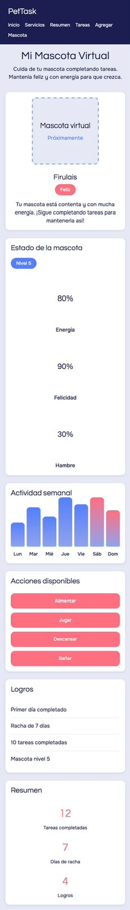 
  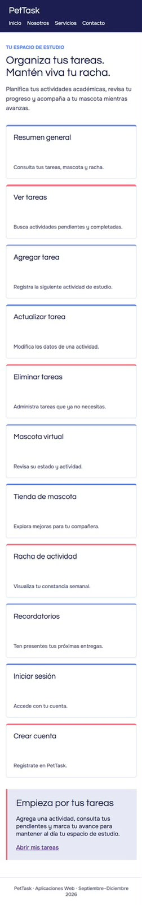
  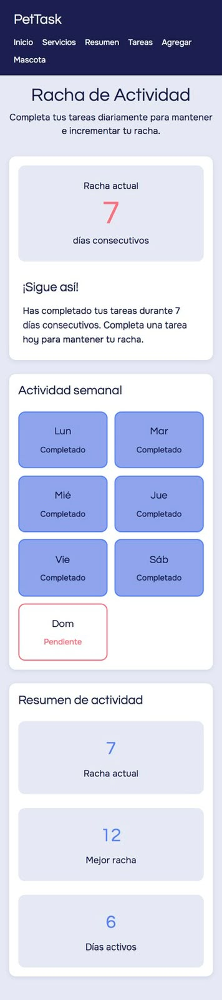
  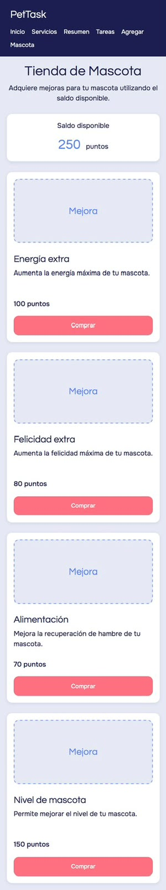
  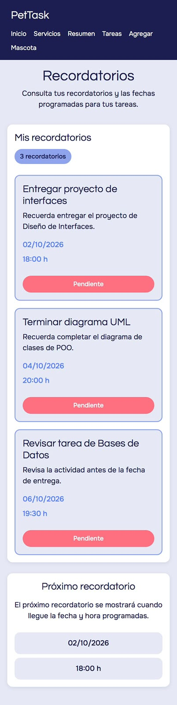
  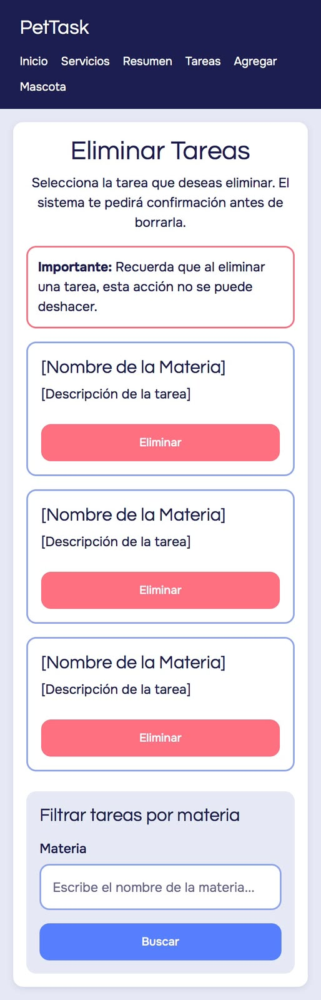
  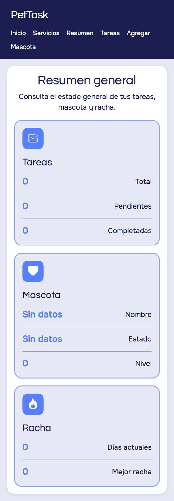
  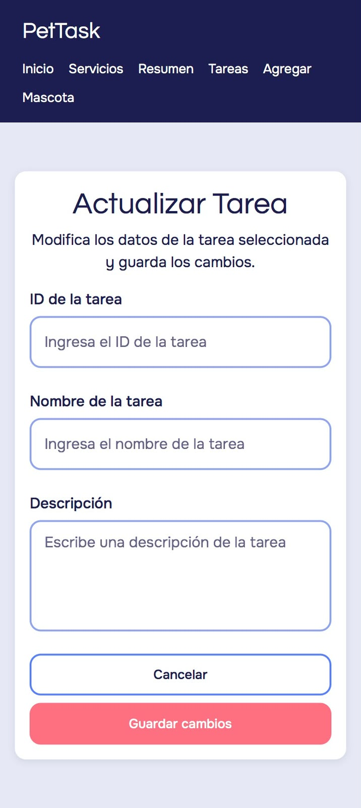
  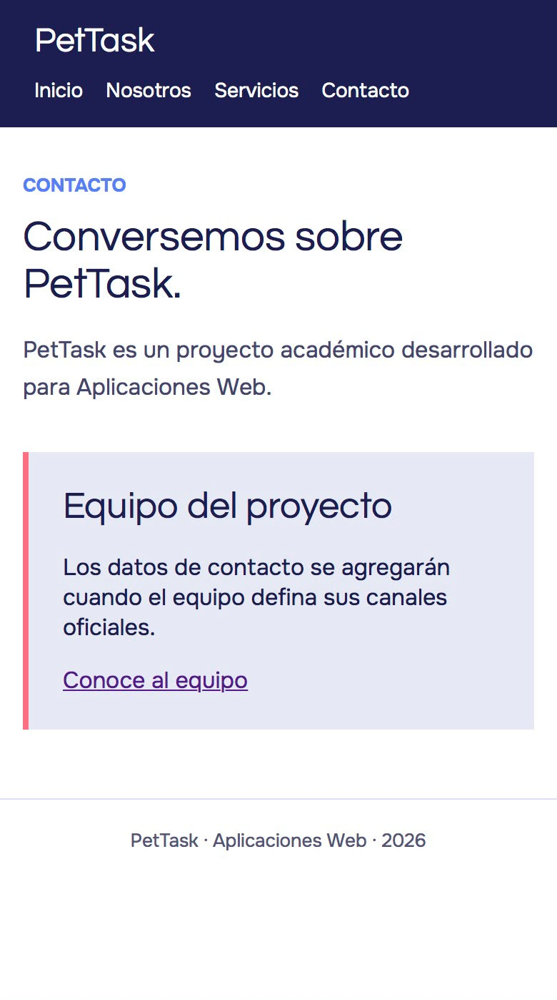
  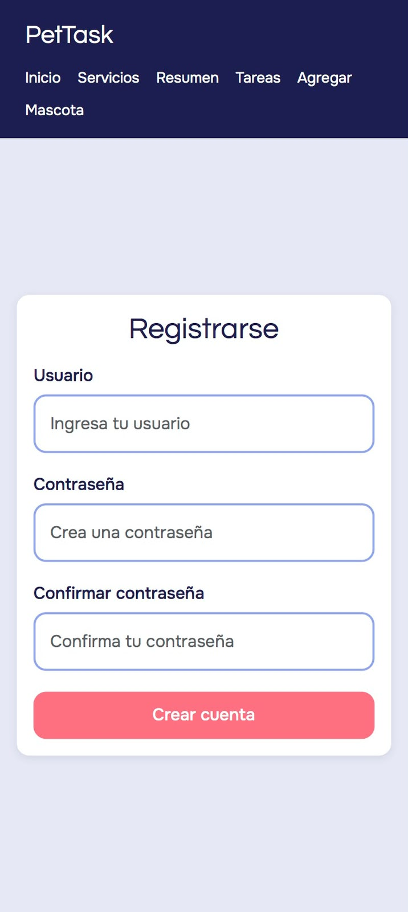
  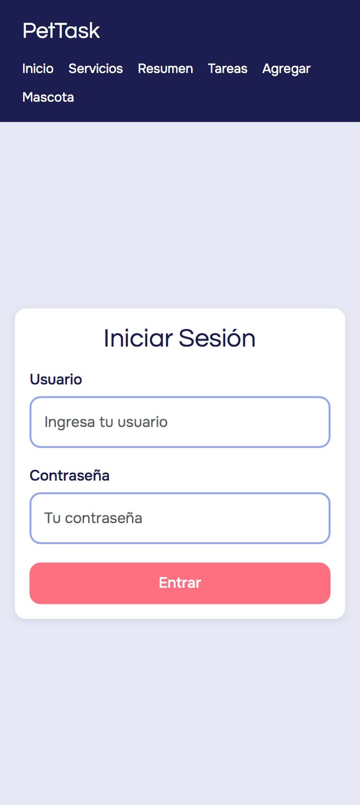
  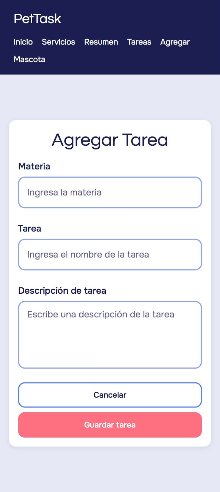
  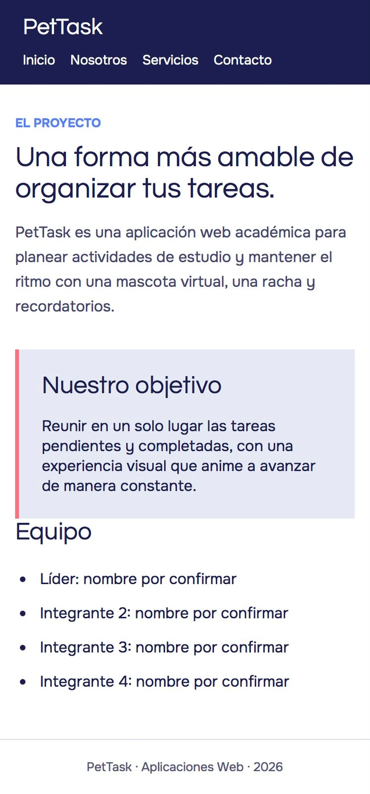
</p>

## Repositorio
El proyecto se encuentra desarrollado utilizando Git y GitHub para llevar un control progresivo del desarrollo.
El repositorio contiene las diferentes versiones y avances realizados durante la construcción de PetTask.
**Repositorio:** [PetTask en GitHub](https://github.com/HolaSoyNickName/PetTask)

---

## Documentación
La carpeta `docs/` contiene los documentos PDF y sus fuentes LaTeX:
- **SRS.pdf / SRS.tex:** Especificación de Requisitos de Software.
- **Guia_Diseno.pdf / Guia_Diseno.tex:** Guía de diseño de PetTask.
---

##


### Registro de Interacciones

| Interacción | Integrante Responsable | Selectores Usados | Eventos Usados | Componente Bootstrap |
|---|---|---|---|---|
| Barra de progreso que avanza según acciones del usuario. | Diego Omar Espinoza Cuevas | Por ID: `#subir-nivel`, `#barra-progreso`, `#nivel-mascota`, `#xp-usuario`, `#texto-progreso`, `#texto-restantes`.<br>Por clase: `.barra-progreso`. | `click`: detecta cuando se pulsa el botón “Subir nivel”. | Barra de progreso (Progress): usa las clases `progress` y `progress-bar`. |
| Modo oscuro con localStorage | Angel Alvarez Del Valle | Por ID: `#btnTema`, `#iconoTema`. | `click`: detecta cuando se pulsa el botón del tema (sol/luna) para alternar entre modo claro y oscuro. | Bootstrap Icons: usa las clases `bi-sun-fill` y `bi-moon-stars-fill`.<br>Atributo `data-bs-theme`: aplica el tema oscuro/claro al `body`. |
| Notificación tras una acción | Sandoval Resendiz Alexander Emir | Por ID: `#producto`, `#btn-comprar`, `#notificacion`.<br>Por clase: `.btn-comprar`. | `click`: detecta cuando se pulsa el botón de compra. | Toast: muestra una notificación de confirmación de compra. |
| Filtrado y búsqueda de elementos | Dector Montiel Norma Angelica | Por ID: `#listaTareas`, `#inputBusqueda`, `#estadoVacio`, `#btnAgregarTarea`. <br>Por clase: `.grupo-filtros`, `.btn-filtro`, `.tarea-item`. <br>Relativos: `.btn-estado`, `.tarea-item` (con `.closest()`). | `click`: detecta cuando se pulsa un botón de filtro o un botón de estado. <br>`input`: detecta la escritura en tiempo real en el campo de búsqueda. | Clases utilitarias: `d-none` (oculta/muestra tareas) y `activo` (resalta el filtro). <br>Cards: contenedor principal y tarjetas de tareas. |


### Evidencia de interacciones


Barra de progreso.


Notificacion tras una acción.


Modo Obscuro


Tablero


### Reflexiones
Espinoza Cuevas Diego Omar

La interacción que me tocó fue la barra de progreso, se me difuculto hacer que avanzara cada vez que presionaba el botón y que el nivel cambiara cuando se llenaba, también tuve que actualizar los XP disponibles para que se reflejaran en la página, usé el evento click para detectar cuándo se presionaba el botóny con JavaScript hice que el progreso y los datos cambiaran sin tener que recargar la página ademas ekl uso de la herramienta de Bootstrap me ayudó a mostrar la barra y a darle una estructura visual, aprendí que JavaScript permite que la página responda a mis acciones y que Bootstrap facilita la presentación de algunos elementos, y al combinar los dos, pude mostrar de forma clara cómo avanzaba el progreso.


Angel Alvarez Del Valle

Para la interacción del modo oscuro implementé el uso de selectores por ID para acceder a los elementos del botón y el ícono del tema, además de eventos de tipo click para alternar entre modo claro y oscuro. Utilicé Bootstrap Icons para cambiar el ícono de sol a luna, y el atributo data-bs-theme para aplicar los estilos del tema. También guardé la preferencia del usuario en localStorage para que se mantenga al recargar la página. Considero que esta interacción fue útil para entender cómo manipular clases y atributos con JavaScript sin necesidad de modificar el CSS directamente. Aprendí que los selectores por ID son ideales cuando se trabaja con elementos únicos, y que combinar JavaScript con componentes de Bootstrap facilita mucho el desarrollo de funcionalidades dinámicas. Me parece importante documentar cada interacción con claridad para que el resto del equipo pueda entender el flujo y dar mantenimiento al código sin problemas.


Sandoval Resendiz Alexander Emir

Durante el desarrollo de la tienda, una de las partes que más se nos complicó fue hacer las notificaciones que aparecen cuando se compra un producto. Tuvimos que lograr que el sistema identificara el nombre del producto seleccionado y que el mensaje apareciera con una animación, permaneciera unos segundos en pantalla y después desapareciera automáticamente.

Con esta actividad aprendimos que usar correctamente los eventos de JavaScript facilita el manejo de los botones y permite agregar más productos sin tener que repetir el mismo código. También aprendimos a combinar JavaScript con Bootstrap y a organizar el código en un archivo independiente llamado tienda-de-mascota.js. Esto nos ayudó a tener una mejor organización y a hacer que la tienda respondiera rápidamente a las acciones del usuario, mejorando así su experiencia al utilizarla.


Dector Montiel Norma Angelica

La interacción que hice fue la de filtrado y búsqueda de tareas. Lo que más se me complicó fue hacer que el filtro por estado y la búsqueda por texto funcionaran al mismo tiempo. Aprendí a usar una sola función para combinar ambos y también a detectar qué botón se presiona sin tener que poner un evento en cada uno. Además, entendí cómo usar clases de Bootstrap, como "d-none", para ocultar elementos. Con esta actividad aprendí a combinar JavaScript con Bootstrap y a hacer mi código más claro y ordenado.


## Proyecto académico
**PetTask**
Aplicaciones Web
Septiembre – Diciembre 2026
